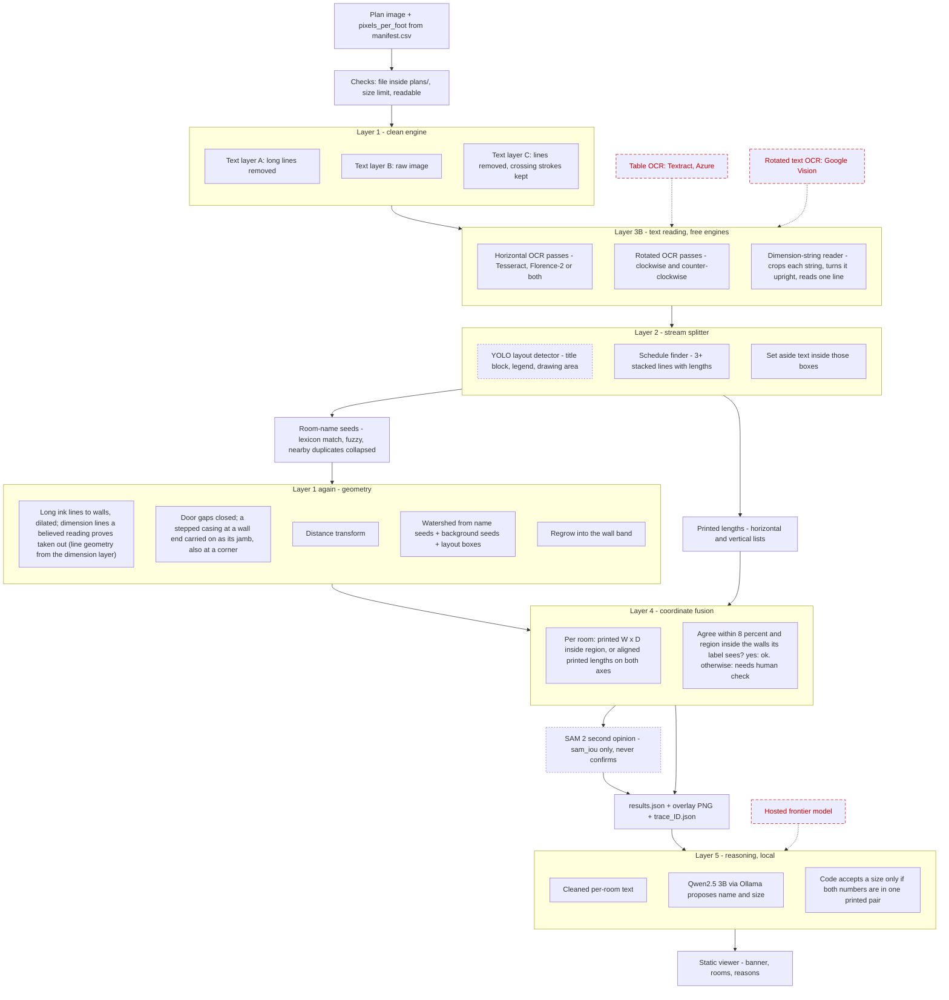
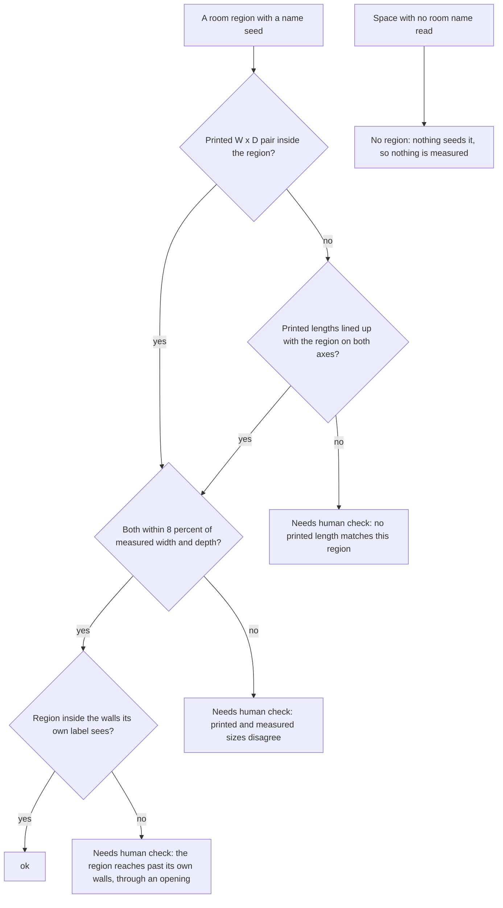
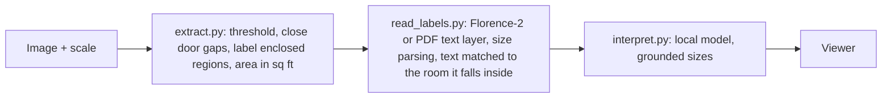

# Process flow

How a plan image becomes a list of rooms, which parts are code and which are models, and where each decision is recorded. Written from the code in `seeded.py` (label-seeded mode); the closed-wall mode is the short path at the end.

Legend: solid box = built and tested here. Dotted box = optional, off by default, not run by the repo author. Red dashed box = excluded by free-only rule; alternatives under review.

## 1. Whole pipeline



The OCR layer is drawn before the splitter because that is the code order: the layout detector runs on the finished OCR results and filters them, it does not run first.

## 2. What decides "ok"



Nothing is marked ok on shape, OCR confidence, SAM 2 overlap or model opinion alone. Agreement with a printed number is still not proof; a length can match by coincidence.

## 3. Where each step is recorded

Every `seeded.py` run writes `trace_<id>.json` (id format `<group id>-<6hex>`, for example `20261011-024724-7f53bd`; the group id is one time snapshot per run shared by every plan and layer, and `viewer/group_<id>.json` indexes the run). Each room in `results.json` carries `trace_ref` pointing at it.

| Flow step | Trace key | What to check |
|---|---|---|
| OCR passes, dimension reader, layout detector, segmentation, SAM 2 | `stages` | seconds and item counts per pass; a pass with 0 items is a silent failure |
| Room-name seeds | `seeds` | `kept` or `collapsed into ...`; a real room collapsed into a neighbour |
| Printed lengths | `dims` | orientation, position and raw OCR text; junk readings |
| Layout boxes | `layout` | class, confidence, box; open `<plan>_layout_overlay.png` |
| Schedule finder | `schedules` | table box and rows; table text must not appear in any room |
| Room verdicts | `rooms` | `aligned_printed_lengths` per axis with `rel_err`, reasons, `sam_iou` |
| Anything suspicious | `warnings` | for example "no vertical printed lengths were read", "room-name text inside layout boxes was set aside" |

## 4. Closed-wall mode (short path)

For plans whose walls form closed rooms.



Do not run `read_labels.py` after `seeded.py`: it re-measures rooms with the closed-wall method and overwrites the seeded results.

## 5. Run order

```
MODE=closed bash run_layers.sh                              # walls form closed rooms
MODE=seeded ENGINE=both bash run_layers.sh                  # names first, then regions
DIMS=1 DIMS_READER=trocr MODE=seeded bash run_layers.sh     # dimension chains read first, then the lines they prove kept out of the walls
LAYOUT=1 MODE=seeded ENGINE=both bash run_layers.sh         # plus the optional YOLO splitter
python seeded.py --sam2                                     # plus the optional SAM 2 second opinion
```

Copy `viewer/results.json` and the trace file after each run; the next run overwrites `results.json`.
